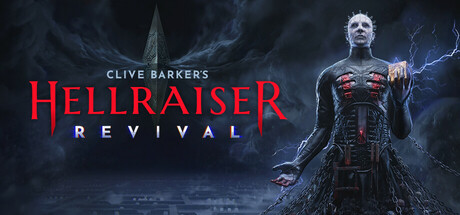

**Hellraiser: Revival is the horror game adaptation of Clive Barker's iconic Hellraiser franchise, featuring the Cenobites and the mysteries of the Lament Configuration puzzle box. Features atmospheric horror and dark supernatural encounters.**

---

## 📖 About

Hellraiser: Revival is the horror game adaptation of Clive Barker's iconic Hellraiser franchise, featuring the Cenobites and the mysteries of the Lament Configuration puzzle box. Features atmospheric horror and dark supernatural encounters.

## ⚠️ Problems Without Trainer

| Problem | Status |
|---------|--------|
| **Puzzle Box Mechanics** — Lament Configuration puzzles require understanding Cenobite lore to solve | ✅ Solved |
| **Resource Scarcity** — Survival items strictly limited; confronting Cenobites directly is suicidal | ✅ Solved |
| **Dark Environments** — Poor visibility is intentional but makes navigation genuinely challenging | ✅ Solved |
| **Boss Encounters** — Cenobite confrontations require very specific evasion and puzzle solution approaches | ✅ Solved |

## ✅ Solution

The **Clive Barker's Hellraiser: Revival Trainer** solves all these issues by giving you complete control over the game.

## 🎯 Full Feature List

- Unlimited Resources
- God Mode / Invincibility
- Instant Skill Cooldown
- One-Hit Kill
- Freeze Game Timer
- Unlock All Items & Achievements
- Custom Speed Multiplier
- Save State Anywhere

## 🚀 Quick Start

1. **Disable Windows Defender** temporarily (trainer may trigger false positive)
2. Download the trainer from the button above
3. Launch Clive Barker's Hellraiser: Revival
4. Run the trainer as Administrator
5. Activate desired cheats with hotkeys

## 💎 Free vs Paid

| Feature | Free | Pro |
|---------|------|-----|
| Basic God Mode | ✅ | ✅ |
| Unlimited Resources | ✅ | ✅ |
| All Advanced Cheats | ❌ | ✅ |
| Auto-Updates | ❌ | ✅ |
| Priority Support | ❌ | ✅ |

## 💻 Requirements

- Windows 10/11 (64-bit)
- Clive Barker's Hellraiser: Revival (any version)
- .NET Framework 4.8+
- DirectX 11+

## 🍎 macOS

macOS users can use our alternative tool:

## ⚖️ Legal

This trainer is for educational and single-player use only. Use responsibly.

---

